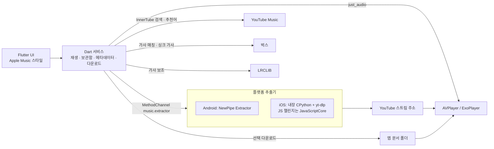

# Drizon 기술 문서

이 문서는 2026년 11월 13일 작업 트리의 Drizon 1.0.0 소스를 기준으로 합니다. 구성 요소별 출처와 라이선스는 [오픈소스 및 외부 의존성](OPEN_SOURCE.md)에 정리했습니다.

## 실행 구조

Drizon은 iOS와 Android에서 실행하는 Flutter 앱입니다. **서버가 없습니다.** 검색, 스트림 주소 추출, 커버·가사 조회는 모두 기기에서 각 서비스에 직접 요청합니다. 재생은 스트리밍이 기본이며, 사용자가 고른 곡만 기기에 내려받습니다.

| 영역 | 구현 |
| --- | --- |
| 화면 | [ui/](../lib/ui/)가 탭(지금 듣기 · 비디오 · 보관함 · 검색), 미니 플레이어, 지금 재생 중 화면, 영상 플레이어를 그립니다. 보관함의 [커버 플로우](../lib/ui/widgets/cover_flow.dart)는 하나의 위치 값으로 모든 커버의 회전·크기·반사를 계산하고, 가운데 커버를 마지막에 그려 항상 위에 둡니다. |
| 디자인 | [Liquid Glass](../lib/ui/glass/liquid_glass.dart): 뒤 콘텐츠를 블러하고 채도를 높여 색이 비치게 하고, 윗면 반사광과 두 방향 림 라이트, 연속 곡률(스쿼클) 모서리를 그립니다. 탭바와 미니 플레이어는 화면 위에 떠 있어 콘텐츠가 그 아래로 스크롤됩니다. 누르면 스프링으로 눌렸다 돌아오고, 탭바 선택 표시는 이동 속도만큼 늘어났다가 출렁이며 자리를 잡습니다. 탭 전환은 확대와 페이드, 미니 플레이어의 커버는 Hero로 지금 재생 화면에 이어집니다. 지금 재생 배경은 블러한 커버 두 겹이 천천히 돌며 움직이고, 가사는 현재 줄을 키우고 나머지를 흐리게 합니다. |
| 로고 | [DrizonLogo](../lib/ui/brand/drizon_logo.dart)는 에이투지체(굵은 "Drizon", 가벼운 "Music")로 쓰고 "o"를 [LP판](../lib/ui/brand/vinyl_record.dart)으로 그립니다. 폰트는 9가지 굵기를 원본 그대로 넣었습니다. 판은 재생 중 33⅓ RPM으로 돌고 관성처럼 가속·감속하며, 반사광은 따로 그려 회전하지 않습니다. |
| 상태 | `provider`의 ChangeNotifier들이 재생([PlayerService](../lib/services/player_service.dart)), 보관함([LibraryService](../lib/services/library_service.dart)), 커버·가사([MetadataService](../lib/services/metadata_service.dart)), 다운로드([DownloadService](../lib/services/download_service.dart))를 나눠 맡습니다. 화면은 `context.select`로 필요한 값만 구독해, 재생 위치가 바뀔 때 전체가 다시 그려지지 않습니다. |
| 저장 | 좋아요, 기록, 플레이리스트, 재생 상태, 설정, 곡별 매칭 결과, 다운로드 목록을 SharedPreferences에 JSON으로 저장합니다. |

## 검색

1. [YouTube Music 엔진](../lib/services/engines/ytmusic_client.dart)은 웹 앱과 같은 비공식 InnerTube API(`WEB_REMIX` 클라이언트)를 호출합니다. 첫 요청 때 music.youtube.com 페이지에서 `INNERTUBE_CLIENT_VERSION`과 `VISITOR_DATA`를 읽고, 실패하면 내장 버전을 씁니다. 너무 오래된 버전은 오류 없이 빈 결과를 받습니다.
2. 일반 검색 결과에서 **"노래" 필터 칩**의 파라미터를 읽어 노래 전용 검색을 한 번 더 합니다. 이 값은 바뀌므로 코드에 고정하지 않습니다. 음원 카탈로그가 없는 지역에서는 칩이 없으며, 이때는 일반 결과만 씁니다.
3. 결과 행은 위치가 아니라 연결 대상으로 해석합니다. 아티스트·앨범 페이지로 가는 링크를 기준으로 분류하고, 재생 시간은 형식으로 알아봅니다. `musicVideoType`으로 음원(ATV), 뮤직비디오(OMV), 일반 영상을 구분하고 이 순서로 정렬합니다. 팟캐스트 에피소드는 제외합니다. 403·429·5xx 응답은 간격을 늘려 두 번 재시도합니다.
4. 입력 중에는 `music/get_search_suggestions`로 추천어를 보여줍니다. YouTube Music 검색이 실패하면 플랫폼 추출기의 검색으로 대체합니다.

## 스트리밍과 다운로드

1. 재생할 때마다 [MusicService](../lib/services/music_service.dart)가 MethodChannel로 스트림 주소와 필요한 HTTP 헤더를 받아 just_audio에 넘깁니다. Android는 NewPipe Extractor, iOS는 앱에 내장한 CPython 위의 yt-dlp를 씁니다. 둘 다 실패하면 Dart 구현(youtube_explode_dart)으로 대체합니다.
2. iOS에서는 서브프로세스를 띄울 수 없어 yt-dlp의 JS 런타임(deno 등)을 쓸 수 없습니다. [drizon_jsc.py](../ios/PythonApp/app/drizon_jsc.py)가 yt-dlp의 `JsChallengeProvider`를 구현하고, Swift가 넘긴 함수 포인터를 ctypes로 호출해 [JavaScriptCore](../ios/Runner/JSSolver.swift)에서 챌린지 스크립트를 실행합니다. AVPlayer가 WebM/Opus를 재생하지 못하므로 포맷은 AAC(m4a)를 우선합니다.
3. yt-dlp는 설정에서 업데이트할 수 있습니다. PyPI에서 wheel을 받아 SHA-256을 확인한 뒤 앱 지원 폴더에 두고, 다음 실행부터 번들 버전보다 먼저 불러옵니다. 함께 필요한 yt-dlp-ejs 버전은 yt-dlp 메타데이터의 고정값을 따릅니다.
4. [다운로드](../lib/services/download_service.dart)는 노래와 영상 모두 선택 기능입니다. 재생과 같은 스트림 주소를 10 MB 단위 Range 요청으로 나눠 받습니다. YouTube가 큰 단일 요청의 속도를 제한하기 때문이며, yt-dlp도 같은 방식을 씁니다. `.part` 파일로 받은 뒤 이름을 바꾸고, 실패하거나 취소하면 부분 파일을 지웁니다. HLS 재생목록은 받지 않습니다. 받은 곡은 플레이어가 스트림 주소 대신 로컬 파일로 재생합니다. 앱을 시작할 때 파일이 사라진 항목은 목록에서 정리합니다.
5. 노래를 받으면 **커버와 가사도 함께 저장**합니다(`downloads/<id>.jpg`, `<id>.lyrics.json`). 가사를 먼저 찾고 커버를 나중에 저장하는데, 벅스 매칭이 커버의 보조 출처가 될 수 있기 때문입니다. 받은 곡은 저장된 커버와 싱크 가사를 네트워크보다 먼저 써서 오프라인에서도 앨범 아트, 잠금 화면 커버, 실시간 가사가 모두 나옵니다. 받을 때 오프라인이라 가사를 못 찾았다면 다음에 온라인으로 찾는 순간 저장합니다. 가사를 직접 다시 고르면 저장본을 지우고 새로 저장하며, 다운로드를 지우면 커버와 가사 파일도 함께 지웁니다.

## 비디오 (뮤직비디오 · 음악방송 · 직캠 · 라이브)

1. [비디오 탭](../lib/ui/pages/videos_page.dart)은 YouTube Music 검색 응답의 **"동영상" 필터 칩** 파라미터로 영상만 검색합니다. 카테고리는 검색어에 붙는 단어(`MV`, `무대 음악방송`, `직캠`, `라이브`)로 구분합니다. 검색어가 없으면 재생 기록에서 많이 들은 아티스트 3명의 영상을 선반으로 보여줍니다. 결과에는 채널, 조회수, 재생 시간이 붙습니다.
2. 영상을 열면 음악 재생을 멈춥니다. 플랫폼 추출기가 세 플랫폼 공통 형식(`{headers, hls, formats: [{url, kind, ext, height, bitrate, vcodec, acodec}]}`)으로 포맷 목록을 돌려주고, [VideoStreams](../lib/models/video_streams.dart)가 재생 소스를 고릅니다. HLS가 있으면 적응형 화질로 재생하고, 없으면 가장 높은 합쳐진 MP4를 씁니다. 재생은 `video_player`(iOS AVPlayer, Android ExoPlayer)가 맡습니다. 전체화면은 가로 방향으로 전환합니다.
3. 다운로드 화질은 하나의 MP4(H.264 + AAC)로 만들 수 있는 것만 보여줍니다. YouTube는 영상과 소리가 합쳐진 파일을 보통 360p까지만 제공합니다. 그보다 높은 화질은 H.264 영상 전용 스트림과 AAC 오디오를 각각 받은 뒤 기기에서 합칩니다. iOS는 [AVFoundation 패스스루 내보내기](../ios/Runner/VideoMuxer.swift), Android는 [MediaExtractor와 MediaMuxer](../android/app/src/main/kotlin/com/oye/oye/VideoMuxer.kt)를 쓰며 재인코딩하지 않습니다. VP9(WebM) 전용 화질은 MP4로 만들 수 없어 제외합니다. 받은 영상은 썸네일과 함께 `videos/`에 저장되고 비디오 탭의 "다운로드"에서 오프라인으로 봅니다.

## 앨범 커버와 가사 매칭

곡이 재생을 시작하면 [MetadataService](../lib/services/metadata_service.dart)가 커버와 가사를 미리 찾고, 결과를 곡별로 저장해 한 번만 조회합니다. 찾지 못한 결과도 3일 동안 기억합니다.

1. **질의 만들기.** [SongQuery](../lib/services/engines/matching.dart)는 영상 제목의 `아티스트 - 제목` 패턴을 업로더 이름보다 우선합니다. 대괄호·`feat.`·`Official MV` 같은 표기를 지우고, `Through the Night (밤편지)`처럼 괄호 안의 다른 언어 제목은 별칭으로 남깁니다. 아티스트도 `아이유(IU)`를 `{아이유, iu}`로 나눠 비교합니다.
2. **점수.** 제목 60%, 아티스트 40%를 기본으로 하고 앨범·재생 시간이 맞으면 가산합니다. 커버·노래방·연주곡 표지어가 원본에 없으면 크게 감점하고, Remix·Live 같은 다른 버전도 감점합니다. 아티스트를 넣어 검색한 결과의 상위 3개는 제목이 정확할 때 아티스트 표기가 달라도 신뢰합니다. 카탈로그의 검색엔진이 `BTS`를 `방탄소년단`으로 연결해 주기 때문입니다. 자동 매칭 기준은 0.62점입니다.
3. **커버.** YouTube Music 노래는 정사각형 커버(lh3, 544px)를 처음부터 가집니다. 영상이면 같은 곡을 YouTube Music에서 찾아 음원의 커버와 앨범명을 씁니다. 찾지 못하면 벅스에서 매칭한 곡의 500px 앨범 이미지를 쓰고, 그것도 없으면 영상 썸네일을 정사각형으로 잘라 씁니다.
4. **가사.** [벅스](../lib/services/engines/bugs_client.dart) 검색 페이지에서 후보를 고르고 `/player/lyrics/T/{id}`(`초|가사`를 전각 `＃`로 이은 싱크 가사)를 먼저 받습니다. 싱크 가사가 없으면 일반 가사(`/N/`)를 후보로 보관하고 [LRCLIB](../lib/services/engines/lrclib_client.dart)에서 싱크 가사를 더 찾습니다. LRCLIB는 재생 시간을 알면 5초 이내 후보만 쓰고, 연주곡 표시는 제외합니다. 사용자가 가사 화면에서 벅스 곡을 직접 고르면 그 선택을 우선합니다.
5. **표시.** 지금 재생 중 화면에서 가사를 켜면 현재 줄을 밝게, 지난 줄과 다음 줄을 흐리게 표시하고 현재 줄을 화면 위쪽 30% 지점으로 스크롤합니다. 사용자가 직접 스크롤하면 3초 동안 따라가지 않습니다. 줄을 누르면 그 시점으로 이동합니다.

## iOS 빌드 구성

[setup_python.sh](../ios/scripts/setup_python.sh)가 BeeWare Python-Apple-support의 Python 3.13 iOS 빌드를 받고, yt-dlp·yt-dlp-ejs·certifi(모두 순수 Python)를 `ios/PythonApp/app_packages`에 설치합니다. 이어서 [patch_xcodeproj.rb](../ios/scripts/patch_xcodeproj.rb)가 Runner 타깃에 Swift 소스와 `Python.xcframework`(링크·임베드·서명), Python 폴더 참조, `Install Python` 빌드 단계를 추가합니다. 이 빌드 단계는 표준 라이브러리를 번들에 복사하고 `.so` 모듈을 프레임워크로 바꿉니다. 여러 번 실행해도 결과가 같습니다. 번들은 읽기 전용이라 바이트코드 캐시는 Caches 폴더에 씁니다(`PYTHONPYCACHEPREFIX`). 인터프리터는 앱 시작과 함께 16 MB 스택의 백그라운드 스레드에서 미리 띄웁니다.

## 저장 위치와 외부 통신

| 데이터 | 위치 |
| --- | --- |
| 보관함 · 설정 · 매칭 결과 · 다운로드 목록 | SharedPreferences |
| 다운로드한 음원 · 커버 · 가사 | 앱 문서 폴더의 `downloads/` |
| 다운로드한 영상 · 썸네일 | 앱 문서 폴더의 `videos/` |
| yt-dlp 업데이트 wheel (iOS) | Application Support의 `ytdlp/` |
| 이미지 캐시 · Python 바이트코드 (iOS) | 캐시 폴더 |

검색어는 YouTube Music으로, 영상 ID는 YouTube로 전달됩니다. 가사 조회에는 곡 제목·아티스트가 벅스와 LRCLIB로, 알면 앨범·재생 시간이 LRCLIB로 전달됩니다. yt-dlp 업데이트 확인에는 PyPI를 사용합니다. 계정, 로그인, 분석 도구는 없습니다.

## 테스트

| 명령 | 내용 |
| --- | --- |
| `flutter test` | 보관함 로직, 커버 플로우, 엔진 파서·매칭(실제 응답을 저장한 [픽스처](../test/fixtures/)), 영상 화질·합치기 계획, 다운로드(가짜 HTTP 서버로 분할 수신, 영상 합치기, 커버·가사 동반 저장), 오프라인 가사·커버, 전체 화면 스모크 테스트 |
| `DRIZON_LIVE=1 flutter test test/live_engines_test.dart` | 실제 YouTube Music · 벅스 · LRCLIB 호출 |
| `DRIZON_SHOT_DIR=/tmp/shots flutter test` | 각 화면을 PNG로 저장 |
| `python3 -m unittest discover -s ios/PythonApp/tests` | iOS Python 계층 (setup 후) |

YouTube Music의 노래 항목 픽스처는 직접 구성한 것입니다. 픽스처를 수집한 지역에서는 음원 카탈로그가 제공되지 않아, 확인된 응답 구조에 맞춰 만들었습니다. iOS의 Swift 코드(Python 내장, 영상 합치기)와 Android의 Kotlin 코드(영상 포맷, 합치기)는 Linux 환경에서 작성되어 실제 기기 빌드는 아직 확인하지 않았습니다. 영상 재생과 합치기는 테스트에서 가짜 구현으로 대체했습니다.
